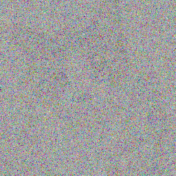

<p align="center">
  
</p>

<h1 align="center">Diffusion Model: Image Generation from Noise</h1>

<p align="center">
  A Denoising Diffusion Probabilistic Model (DDPM) built from scratch in <b>TensorFlow / Keras</b>, using a time-conditioned U-Net to turn pure Gaussian noise into images.
</p>

<p align="center">
  
  
  
  
</p>

---

## Table of Contents

- [Overview](#overview)
- [How It Works](#how-it-works)
- [Model Architecture](#model-architecture)
- [Project Structure](#project-structure)
- [Installation](#installation)
- [Usage](#usage)
- [Configuration](#configuration)
- [Results](#results)
- [References](#references)

---

## Overview

Diffusion models offer state-of-the-art performance in generative AI for images. They are also a key component of broader tools such as text-to-image generators. This project implements a diffusion model end to end: it gradually corrupts training images with noise and trains a neural network to reverse that process, so new images can be generated starting from random noise.

**Highlights**

- Forward noising process with a linear variance (β) schedule
- U-Net denoiser with ResNet blocks, linear and full self-attention, and sinusoidal time embeddings
- Training pipeline on CIFAR-10 via `tensorflow-datasets`
- Automatic checkpointing and resume-from-checkpoint support

<p align="center">
  
  <br>
  <em>Generating an image from noise with the diffusion model.</em>
</p>

---

## How It Works

A diffusion model consists of two processes:

### 1. Forward process (adding noise)

Starting from a clean image $x_0$, Gaussian noise is added over $T$ timesteps according to a fixed schedule $\beta_1, \dots, \beta_T$. Thanks to a closed-form expression, a noisy sample at any timestep $t$ can be drawn directly:

$$
x_t = \sqrt{\bar{\alpha}_t}\, x_0 + \sqrt{1 - \bar{\alpha}_t}\, \epsilon, \qquad \epsilon \sim \mathcal{N}(0, I)
$$

where $\alpha_t = 1 - \beta_t$ and $\bar{\alpha}_t = \prod_{s=1}^{t} \alpha_s$.

### 2. Reverse process (denoising)

A U-Net $\epsilon_\theta(x_t, t)$ is trained to predict the noise $\epsilon$ that was added to the image. The training objective is the simple mean-squared error:

$$
\mathcal{L} = \mathbb{E}_{x_0, t, \epsilon}\left[\, \lVert \epsilon - \epsilon_\theta(x_t, t) \rVert^2 \,\right]
$$

At generation time, the model starts from pure noise $x_T$ and iteratively removes the predicted noise, step by step from $t = T$ down to $1$, until a clean image emerges.

---

## Model Architecture

The denoising network (`Unet` in [`backward_denoising.py`](backward_denoising.py)) follows the standard DDPM U-Net design:

| Component | Description |
|---|---|
| **Time embedding** | Sinusoidal positional embedding → Dense → GELU → Dense |
| **Encoder** | Per resolution: 2 × ResNet blocks (time-conditioned via scale/shift) → Linear attention → Downsample |
| **Bottleneck** | ResNet block → Full multi-head self-attention → ResNet block |
| **Decoder** | Skip connections from the encoder, 2 × ResNet blocks → Linear attention → Upsample |
| **Normalization** | Group normalization in ResNet blocks, pre-norm (LayerNorm) before attention |
| **Output** | ResNet block + 1×1 convolution predicting the noise $\epsilon$ |

Default channel multipliers are `(1, 2, 4, 8)` with a base width of `64`.

---

## Project Structure

```
diffusion-model/
├── parameters.py               # Global hyperparameters (image size, batch size, timesteps)
├── dataset.py                  # CIFAR-10 loading and preprocessing ([-1, 1] scaling, resizing)
├── forwad_noising.py           # Forward diffusion: noise sampling and timestep generation
├── backward_denoising.py       # U-Net denoiser and its building blocks
├── util.py                     # Loss function (MSE between true and predicted noise)
├── Train.py                    # Training loop with checkpointing
├── example.gif                 # Sample generation animation
└── Diffusion Model Pipeline.png  # Project banner
```

---

## Installation

```bash
# Clone the repository
git clone <repository-url>
cd diffusion-model

# (Optional) create a virtual environment
python -m venv .venv
source .venv/bin/activate        # Windows: .venv\Scripts\activate

# Install dependencies
pip install tensorflow tensorflow-addons tensorflow-datasets einops numpy matplotlib tqdm pillow
```

> **Note:** A CUDA-enabled GPU is strongly recommended for training. `Train.py` reserves up to 80% of GPU memory by default.

---

## Usage

### Train the model

```bash
python Train.py
```

The script will:

1. Download and preprocess CIFAR-10 (on first run).
2. Build the U-Net and restore the latest checkpoint from `./checkpoints` if one exists.
3. Train for the configured number of epochs, printing the average loss per epoch.
4. Save a checkpoint after every epoch (keeping the 2 most recent).

---

## Configuration

Hyperparameters live in [`parameters.py`](parameters.py) and [`Train.py`](Train.py):

| Parameter | Default | Description |
|---|---|---|
| `BATCH_SIZE` | `128` | Training batch size |
| `timesteps` | `200` | Number of diffusion steps $T$ |
| β schedule | linear, `1e-4` → `0.02` | Noise variance schedule |
| Image size | `32 × 32` | Resolution after preprocessing |
| Optimizer | Adam, `lr = 1e-4` | Training optimizer |
| `epochs` | `10` | Number of training epochs |

---

## Results

The animation in the [Overview](#overview) section shows the reverse diffusion process: starting from pure Gaussian noise, the trained model progressively denoises the sample into a coherent image.

---

## References

- Ho, J., Jain, A., & Abbeel, P. (2020). [*Denoising Diffusion Probabilistic Models*](https://arxiv.org/abs/2006.11239). NeurIPS.
- Sohl-Dickstein, J., et al. (2015). [*Deep Unsupervised Learning using Nonequilibrium Thermodynamics*](https://arxiv.org/abs/1503.03585). ICML.
- Ronneberger, O., Fischer, P., & Brox, T. (2015). [*U-Net: Convolutional Networks for Biomedical Image Segmentation*](https://arxiv.org/abs/1505.04597). MICCAI.

---

<p align="center">
  If you find this project useful, consider giving it a ⭐
</p>
